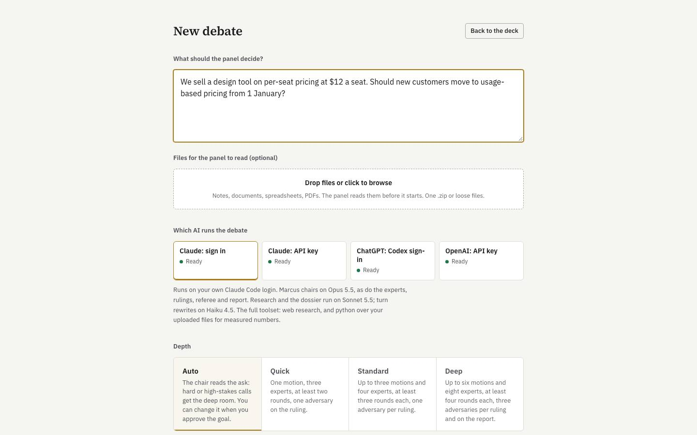
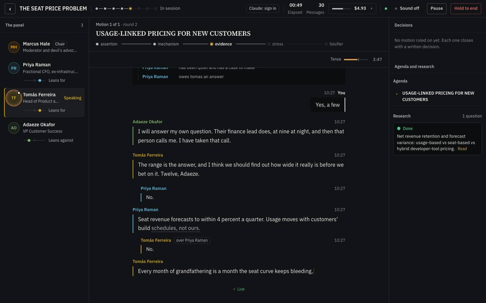
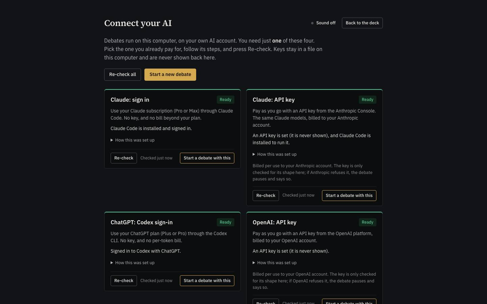
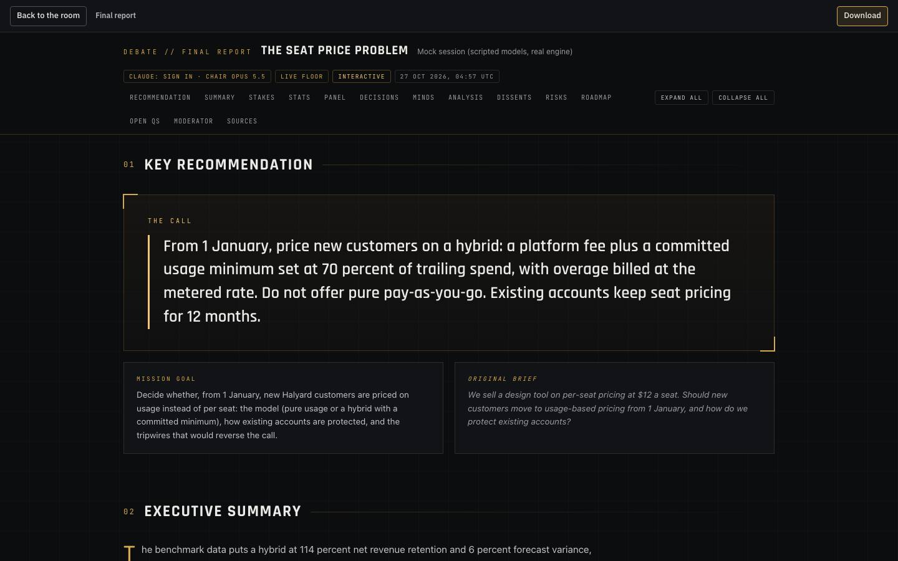

# The Debate App: START HERE

**What it is.** You describe a decision you have to make. A panel of AI experts argues it out in front of you, live, chaired by a moderator called Marcus, and hands you a written report with a ruling on every question.

**Where it runs.** On your own computer, with your own AI account. No hosted service, no sign-up, nothing sent anywhere except to the AI you choose. Free and open source (MIT).

<p>
  
  
  
  
</p>

*(Screenshots from a demo run with scripted models: `npm run e2e:shots` retakes them.)*

You do not need to know how to code. Three steps.

---

## Install in 3 steps

You need two things before you start: **Node.js** version 22.13 or newer (a free helper program the app runs on; step 2 below; the current LTS from nodejs.org is fine) and **one AI account** (see "Connect your AI" below). The first start downloads the rest by itself, so it needs internet and a few minutes. Nothing is compiled, so you need no developer tools (no Visual Studio, Xcode or build tools). Later starts take seconds.

### On a Mac

1. **Get the app.** On this page, under **Releases** on the right, open the latest release and click **debate-app-…zip**. (The green **Code** button, then **Download ZIP**, also works; that copy needs the right-click step below on first start.) Open your Downloads folder and double-click the ZIP to unzip it. Drag the unzipped folder somewhere you will find it, for example Documents.
2. **Install Node.js (once).** Go to [nodejs.org](https://nodejs.org), click the big green **LTS** button, open the file it downloads and click Continue / Install until it finishes. Skip this if you already have Node.js 22.13 or newer; the launcher checks and tells you. An older Node.js is updated the same way.
3. **Start it.** In the app folder double-click **Start on Mac.command**. The first time, macOS may say it "cannot be opened because it is from an unidentified developer": right-click the file, choose **Open**, then click **Open** again. A window with plain text appears, does its setup, and your web browser opens on the app. Leave that window open while you use the app.

### On Windows

1. **Get the app.** On this page, under **Releases** on the right, open the latest release and click **debate-app-…zip** (or click the green **Code** button, then **Download ZIP**). Open your Downloads folder, right-click the ZIP and choose **Extract All**, then **Extract**. Move the new folder somewhere you will find it, for example Documents.
2. **Install Node.js (once).** Go to [nodejs.org](https://nodejs.org), click the big green **LTS** button, open the file it downloads and click Next / Install until it finishes. Keep the default choices. Skip this if you already have Node.js 22.13 or newer; the launcher checks and tells you. An older Node.js is updated the same way.
3. **Start it.** In the app folder double-click **Start on Windows.bat**. If Windows shows a blue "Windows protected your PC" box, click **More info**, then **Run anyway**. A window with plain text appears, does its setup, and your web browser opens on the app. Leave that window open while you use the app.

### On Linux

1. **Get the app.** Download **debate-app-…zip** from the latest release under **Releases** and unzip it (or `git clone` the repository). A **Code → Download ZIP** copy works too but loses the start file's permission; the `chmod` line in step 3 fixes that.
2. **Install Node.js 22.13 or newer (once).** Follow the "Linux" instructions on [nodejs.org](https://nodejs.org/en/download) for the LTS version (with nvm: `nvm install --lts`). Your distribution's own `nodejs` package is often too old.
3. **Start it.** Open a terminal in the app folder and run `./"Start on Linux.sh"` (if it says permission denied: `chmod +x "Start on Linux.sh"` first). Your browser opens on the app.

### Every time after that

Double-click the same start file. It notices nothing has changed, skips the setup, and opens in a few seconds. The window prints a line that says **Open this link** with the address (normally `http://127.0.0.1:8794`). If your browser did not open, copy that address into it. To stop the app, close the window.

If the usual port is taken by another program, the app uses the next free one and tells you which. Nothing to do.

Want a look around before connecting any AI? Open the **Try Demo** file for your system (on Linux, run `./"Try Demo on Linux.sh"`). It runs a sample debate with scripted AI answers: no AI account and no model usage. The first start still needs Node.js and an internet connection to install the app's dependencies.

---

## Connect your AI

The app uses **your own** AI account, so you pay your AI provider directly and nobody else is involved. It never asks you to pick a model: the app chooses the right one for each job. Pick whichever of these four you already have:

| | You have | What to do |
|---|---|---|
| 1 | **Claude: sign in** (a Claude Pro or Max plan) | Install Claude Code, run `claude` once in a terminal and sign in. |
| 2 | **Claude: API key** (pay Anthropic per use) | Put `ANTHROPIC_API_KEY=your-key` in a file named `.env` in the app folder. |
| 3 | **ChatGPT: Codex sign-in** (a ChatGPT plan) | Install the Codex CLI and run `codex login`. |
| 4 | **OpenAI: API key** (pay OpenAI per use) | Put `OPENAI_API_KEY=your-key` in a file named `.env` in the app folder. |

Full click-by-click instructions for each: **[docs/CONNECT-YOUR-AI.md](docs/CONNECT-YOUR-AI.md)**.

You only need one. If nothing is connected yet, the app opens a **Connect your AI** screen that checks all four and shows what to do. After you change `.env` or sign in, press **Re-check** there; no restart needed. On the New debate screen you then choose which of your connected AIs to use for that debate.

---

## What your first debate looks like

1. **Write the topic.** A paragraph about the decision, with as much context as you can: numbers, constraints, what you are leaning toward. You can attach files (documents, spreadsheets, PDFs).
2. **Answer a few questions.** If something is unclear, Marcus asks. Then he states the goal. You say *yes* or *change this*.
3. **Meet the panel.** The app invents named experts who fit your topic. You approve them or ask for changes.
4. **Approve the agenda.** A short list of questions ("motions") to settle, in order. Approve or revise.
5. **Watch.** The experts argue live. Marcus may ask *you* a question mid-debate; the room waits for you. You can close the tab and come back: nothing is lost.
6. **Read the report.** A written ruling on every question, with the reasoning, the sources and the strongest objections. It is saved in your library of past debates.

Debates are thorough, not quick: often an hour or more. The app is built for hard decisions. The app puts quality before cost, so there is **no spending limit unless you set one**. Costs vary by provider, topic and research: a measured Claude research call alone used about $4 at list price, and current estimates have not yet been calibrated against complete live debates. Details and the optional spending limit: [docs/REFERENCE.md](docs/REFERENCE.md).

---

## FAQ

**Is my information sent anywhere?** Only to the AI provider you connected, for the debate you started, through your own account. No tracking, no analytics, no server of ours, no accounts. The app's pages load nothing from the internet.

**Do I need to code or use a terminal?** No. Double-click the start file and use the browser. (The only terminal steps are signing in to Claude or Codex once, if you choose those.)

**Can I choose the model?** No, on purpose. Each job in the debate gets the model best suited to it.

**What does it cost?** The app is free. You pay your AI provider as you normally would. Debate costs are not yet reliably measured; a single Claude research call has used about $4 at list price, and a full debate may cost considerably more. Subscription use consumes part of your allowance. You can set your own spending ceiling per debate.

**Can I run a debate and walk away?** Yes. Debates survive closing the tab and restarting the app. If you run out of AI usage the debate pauses, then continues by itself when your allowance returns. Nothing is lost.

**Can I use it from my phone or another computer?** It is built for one person on one computer. An optional Telegram message can tell you when a debate needs you: see [docs/REFERENCE.md](docs/REFERENCE.md).

**Where are my debates stored?** In the `data` folder inside the app folder, on your computer, unencrypted. Treat it like the documents in it.

**How do I update?** Download the new ZIP, copy your old `data` folder (and `.env` if you made one) into the new folder, and start as usual.

**How do I uninstall?** Delete the app folder. Node.js can be removed like any other program.

---

## Troubleshooting

**Node.js is missing or too old.** The start window says so and offers to open nodejs.org. Install the **LTS** version, then double-click the start file again. If you just installed it and still see the message, close the start window and open it again. You need version 22.13 or newer (the app uses the database built into Node.js from that version); installing the current LTS over an older Node.js updates it.

**macOS says the file cannot be opened.** Right-click **Start on Mac.command**, choose **Open**, then **Open**. You only need to do this once. If nothing happens at all (most likely with a **Code → Download ZIP** copy, which GitHub saves without the file's "can run" permission; the release zip keeps it), open Terminal, type `chmod +x ` (with a space after it), drag the file into the Terminal window, press Enter, then try again.

**Windows shows "Windows protected your PC".** Click **More info**, then **Run anyway**. Windows does this for any file that did not come from its store.

**The window says another port is being used.** That is fine and automatic: it picks another one. Use the link on the **Open this link** line.

**The browser did not open.** Copy the address from the **Open this link** line into your browser.

**"Not signed in" or the AI you picked is greyed out.** The app cannot find your login or key. Open **Connect your AI** from the home screen: each card says what is missing. Follow the steps (also in [docs/CONNECT-YOUR-AI.md](docs/CONNECT-YOUR-AI.md)), then press **Re-check**. For a technical checklist of this computer, run `npm run doctor` in a terminal in the app folder; it names the exact fix.

**It looks stuck or slow.** Real debates take a long time because several experts think and research in turn. If the top bar says "Paused: waiting for quota" you have used up your AI allowance for now; it resumes by itself. If nothing moves for 15 minutes, refresh the page; the app picks up where it left off. The very first start is also slow: it is downloading and building.

**The first start failed while downloading.** Check your internet connection and double-click the start file again; it carries on.

**No PDF report.** PDF needs Google Chrome or Chromium installed. The web version of the report always works.

**I want to check without starting anything.** In a terminal in the app folder: `npm start -- --check`.

Still stuck? Open an issue on this repository and include the text from the start window.

---

## Is it safe?

- **It stays on your computer.** The app only answers requests from your own machine. Other computers on your network cannot reach it.
- **Your logins and keys stay yours.** The app does not store them. Your Claude or Codex login stays where those programs keep it; an API key is read from your `.env` file and is never shown or logged.
- **Your files are treated as untrusted.** Documents you attach are read by AI as data, not instructions. Any code the AI runs on your files runs in a sandbox with no internet access and no access to your logins. The AI that reads your files cannot browse the web. Still, only attach files you trust.
- **On a shared computer, set a password.** With the default settings there is no sign-in, so anyone using the same computer can open the app. Add `ACCESS_PASSWORD=something-private` to your `.env` file to put a sign-in screen in front of it.
- **It spends your AI allowance.** A debate keeps working, and using your account, until it finishes or you end it. The meter at the top shows usage.
- **Nothing is sent to us.** There is no telemetry.

The technical details are in [SECURITY.md](SECURITY.md).

---

## Learn more

- [How it works, in plain language](docs/HOW-IT-WORKS.md)
- [Connect your AI](docs/CONNECT-YOUR-AI.md)
- [Reference: depth, cost, every setting, Telegram](docs/REFERENCE.md)
- [Running in Docker (advanced)](docs/DOCKER.md)

---

## For contributors

MIT licensed. See [CONTRIBUTING.md](CONTRIBUTING.md), [CODE_OF_CONDUCT.md](CODE_OF_CONDUCT.md) and the docs index in [docs/README.md](docs/README.md).

```bash
git clone https://github.com/deveshsingh1209/debate-app.git && cd debate-app
npm install
npm start            # installs/builds if needed, serves on 127.0.0.1, opens the browser
npm run dev          # server in watch mode + the web app on http://localhost:5173
npm run typecheck && npm run build
npm run qa           # offline self-tests, no network and no keys
npm run security-test
npm run doctor       # checks this machine and your AI connections, no model calls
```

Layout: `shared/` the contract between server and web and the one place that names models; `server/` the Fastify server and debate engine; `web/` the React app; `scripts/` start and doctor scripts; `docs/` architecture, API contract, security audits, roadmap. The full command table is in [docs/REFERENCE.md](docs/REFERENCE.md#development).

## Licence

MIT. See [LICENSE](LICENSE). The fonts and packages the app uses keep their own licences: [THIRD_PARTY_NOTICES.md](THIRD_PARTY_NOTICES.md). What changed in each version: [CHANGELOG.md](CHANGELOG.md).
